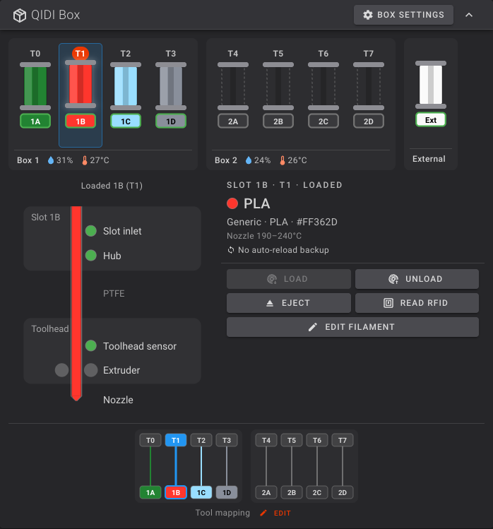
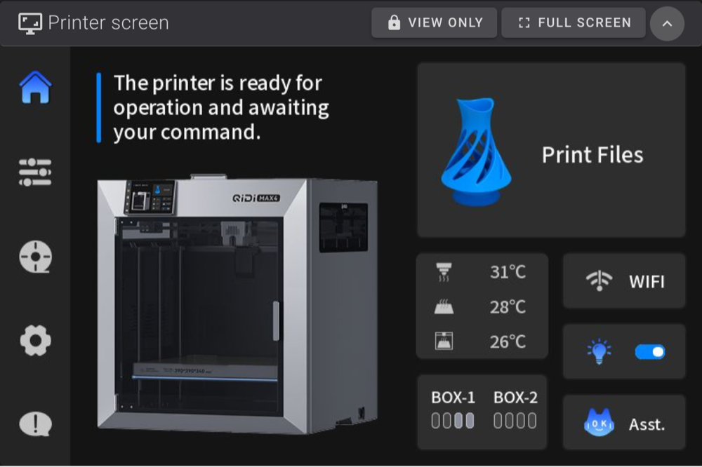
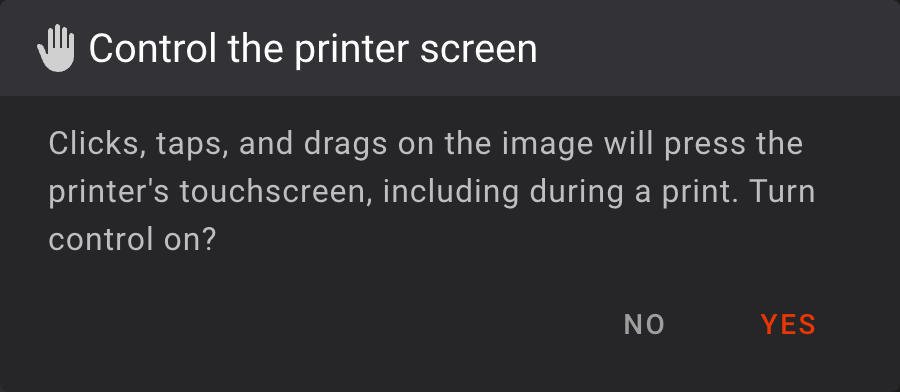

# Fluidd for the QIDI Max 4

This is Fluidd for the QIDI Max 4: current upstream [Fluidd](https://github.com/fluidd-core/fluidd) with QIDI's Max 4 additions and the QIDI Box, temperature, and screen features below. QIDI no longer updates the Fluidd 1.30.5 that ships with the Max 4. The `qidi` branch is kept rebased onto upstream releases.

**To install it,** use [Qidi Max 4 Optimized](https://github.com/thelegendtubaguy/Qidi-Max-4-Optimized). It serves this build alongside QIDI's Fluidd, which stays on the printer untouched, and uninstalling switches back to QIDI's. Your Fluidd settings, macros, and dashboard layout carry over. The footer of every page shows which one is in use: this build reads `fluidd: v` followed by its version, `-tltg-`, and a commit ID.

**To report a problem,** open an issue on [Qidi Max 4 Optimized](https://github.com/thelegendtubaguy/Qidi-Max-4-Optimized/issues).

## QIDI Box card

The **QIDI Box** card shows every Box's slots and the external spool at once, and is hidden on printers without a Box.

- **Slots:** each spool shows its color, with the tools mapped to it above. The slot label below has a green border when filament is at the slot's inlet, and the loaded slot's tool label is highlighted.
- **Box status:** humidity and temperature under each Box, plus the heater target while it's heating.
- **Filament path:** how far the selected slot's filament reaches, following the slot inlet, hub, and toolhead sensors. The hub and toolhead only light up for the slot whose filament is actually there.
- **Automatic reload:** when it's on, slots that can stand in for each other when one runs out share a reload letter (↻ A, ↻ B, …) and are outlined in their filament color. These are Box slots with the same filament, vendor, and color. The selected slot also lists its backups.
- **Actions:** click a slot, then **Load**, **Unload**, **Eject**, **Read RFID**, or **Edit filament**. These are unavailable while printing or while the Box is busy.
- **Tool mapping:** the bottom of the card shows which slot each tool loads, one diagram per Box. While the printer is idle, click a tool or **Edit** to change it. **Default** restores T0 → 1A, T1 → 1B, and so on.
- **Box settings:** QIDI's detection on startup, detection on insertion, and automatic reload switches, and the Box's [load and unload motion](https://github.com/thelegendtubaguy/Qidi-Max-4-Optimized/blob/main/docs/qidi-box.md#load-and-unload-speed).

### Filaments

On firmware `01.01.07.01`, slots show the filament, vendor, and color the printer is actually using, including brands such as Bambu, HATCHBOX, Overture, and Polymaker. The Vendor and Filament pickers match the touchscreen, colors are saved the same way as on the touchscreen, and the buttons send the commands `01.01.07.01` uses. A slot set with an older numeric ID shows QIDI PLA Basic, because that's how `01.01.07.01` treats it; pick the filament again to fix it. Older firmware uses QIDI's earlier filament list and commands.

The pickers read QIDI's filament list, which you can [edit from Fluidd](https://github.com/thelegendtubaguy/Qidi-Max-4-Optimized/blob/main/docs/qidi-box.md#editing-qidis-filament-list). If Fluidd can't read the list, the card says so instead of offering **Edit filament**.

### Printing with the Box

Starting a print of a file sliced for the Box opens the Box print dialog. Choose a loaded slot for each filament in the file. Slots are matched automatically by type and nearest color, and several filaments can use the same slot. Turn off **Use QIDI Box** to print from the external spool.

The print uses the mapping you chose, and a normal print end restores the default.

## Box heater

Set a Box's heater target from the `Heater Box1`/`Heater Box2` rows in the temperature panel. The highest target allowed is the lowest Box temperature limit among the filaments loaded in that Box; an empty Box allows up to 65 °C, the Box's advertised maximum. If a loaded filament shouldn't be heated in the Box, the field is locked, though a Box that's already heating can still be set to `0`.

## Printer screen card

The **Printer screen** card shows the printer's touchscreen live, so you can check or use it from another room.

- **It starts collapsed,** and the printer does no screen work until you expand it. It stops when you collapse it, leave the dashboard, or switch to another tab.
- **It opens view only:** clicking or tapping the image does nothing on the printer.
- **To control the printer,** choose **View only** in the card's header and confirm. Clicks, taps, and drags on the image then press the real touchscreen, including during a print. Collapsing the card turns control back off.
- **Full screen** fills your browser or phone screen with it.

Only devices that can already use Fluidd can see the screen. Existing dashboards get the card at the bottom of the first column; drag it wherever you like in layout mode. If the printer's screen service isn't installed, the card says the screen is unavailable.

## Other changes from QIDI's Fluidd

- Everything QIDI's **Enable Full Display** setting used to hide, such as the bed mesh card on the Tune page and sensors without a target temperature, is always shown.
- Sliced `.gcode.3mf` files can be uploaded, and the G-code preview opens them.
- Open tabs switch to a newly installed version by themselves within a few minutes, or as soon as the tab is shown again.
- Everything upstream Fluidd has added since 1.30.5.

---

# Fluidd

Fluidd is a free and open-source Klipper web interface for managing your 3d printer.

## Features

- Responsive UI, supports desktop, tablets and mobile
- Customizable layouts. Move any panel where YOU want
- Built-in color themes
- Manage multiple printers from one Fluidd install
- [See our docs for more!](https://docs.fluidd.xyz)

## Support & Documentation

See our [Docs](https://docs.fluidd.xyz).
Join our [Discord!](https://discord.gg/GZ3D5tqfcF).

Want to help out? Read the [contributing guidelines](/CONTRIBUTING.md) and our [code of conduct](/.github/CODE_OF_CONDUCT.md).

Found a security issue? Please follow our [security policy](/.github/SECURITY.md).

## How to use?

Fluidd can be easily installed via [KIAUH](https://github.com/dw-0/kiauh), along with Klipper, Moonraker, and all of the required dependencies.

Please see the [docs](https://docs.fluidd.xyz) for help with installation and configuration.

## Where to download?

You can download the latest release [here](https://github.com/fluidd-core/fluidd/releases/latest).

Older releases can be found [here](https://github.com/fluidd-core/fluidd/releases).

## Docker support

We have an [official docker image](https://github.com/fluidd-core/fluidd/pkgs/container/fluidd), serving Fluidd by default on port 80.

For those who have specific security requirements and need/want to run an unprivileged container, we also have an [unprivileged docker image](https://github.com/fluidd-core/fluidd/pkgs/container/fluidd-unprivileged) available, serving Fluidd by default on port 8080.

Both of these docker images are updated for each release and on each commit.

## Official sponsors

LDO, Excellence in Motion. LDO is an official sponsor of Fluidd.

## Supporting Fluidd

Fluidd development is driven by passionate volunteers who dedicate their time to improving and expanding its capabilities.

Your sponsorship can help us enhance Fluidd, introduce new features, and ensure it remains accessible to all Klipper users.

Your support can make a significant impact on the evolution of Fluidd. Please consider [sponsoring Fluidd](https://github.com/sponsors/fluidd-core).

## Credits

A big thank you to:

- the [Voron Community](http://vorondesign.com/)
- Kevin O'Connor for [Klipper](https://github.com/Klipper3d/klipper)
- Eric Callahan for [Moonraker](https://github.com/Arksine/moonraker)
- Dominik Willner for [KIAUH](https://github.com/dw-0/kiauh)
- Ray for [MainsailOS](https://github.com/raymondh2/MainsailOS)

## Misc

This project is tested with BrowserStack
